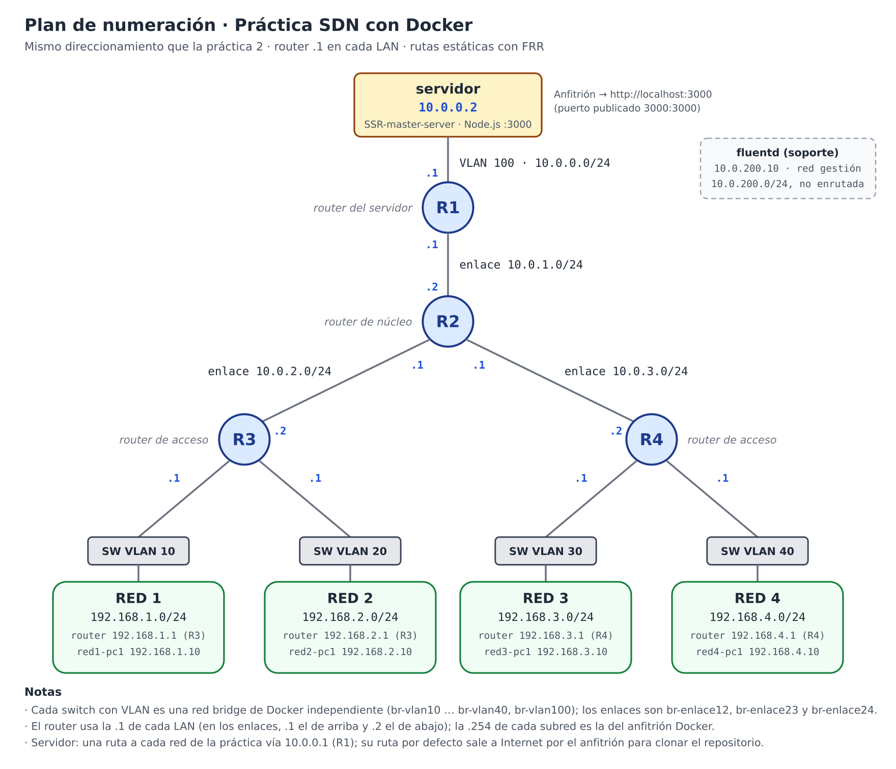

# Práctica · Red definida por software (SDN) con Docker Compose

Despliegue automatizado de la red del laboratorio 3103: un servidor web, cuatro
routers con **FRR (Free Range Routing)** y cuatro subredes de usuario (RED 1–4)
detrás de switches con VLAN. Además, **fluentd** recoge los logs de FRR de cada
router y la salida de los contenedores.

El script `desplegar_red.py` **genera** el `docker-compose.yml` y todos los ficheros
de configuración, **levanta** el escenario y ejecuta el **plan de pruebas**.



## Contenido

| Fichero / carpeta | Qué es |
|---|---|
| `desplegar_red.py` | Script principal (Python 3.7+, solo biblioteca estándar) |
| `escenario/docker-compose.yml` | Compose generado: 10 contenedores y 9 redes |
| `escenario/router/` | Dockerfile (Ubuntu 22.04 + FRR) y `entrypoint.sh` de los routers |
| `escenario/config/R1..R4/frr.conf` | Configuración de FRR de cada router (rutas estáticas) |
| `escenario/servidor/` | Dockerfile (Ubuntu 22.04 + Node.js + git) y `entrypoint.sh` que clona y ejecuta SSR-master-server |
| `escenario/host/` | Dockerfile y `entrypoint.sh` de los PCs de RED 1–4 |
| `escenario/fluentd/conf/fluent.conf` | Configuración de fluentd |
| `escenario/fluentd/shared-volume/frr/` | Aquí escribe FRR su log (volumen compartido con fluentd) |
| `escenario/fluentd/output/` | Aquí guarda fluentd los datos recogidos |
| `escenario/topologia.json` | Plan de numeración y rutas en formato máquina |
| `plan_numeracion.png` / `.svg` | Dibujo del plan de numeración |

Todo lo que hay en `escenario/` lo genera el script: si quieres cambiar algo, cambia el
script y ejecuta `python3 desplegar_red.py generar`.

## Requisitos

- Docker Engine o Docker Desktop con Compose (recomendado `docker compose` v2; también funciona `docker-compose` v1).
- Python 3.7 o superior.
- Acceso a Internet: para construir las imágenes (`apt-get`) y para que el servidor clone el repositorio de GitHub e instale sus dependencias con `npm`.
- En Linux, que tu usuario esté en el grupo `docker` (o ejecutar con `sudo`).

## Puesta en marcha

```bash
python3 desplegar_red.py            # genera, construye, levanta y prueba todo
```

La primera vez tarda unos minutos (construcción de las imágenes y `npm install` en el
servidor). Al terminar ejecuta automáticamente el plan de pruebas y deja el informe en
`escenario/resultados_pruebas.txt`.

Otras órdenes:

```bash
python3 desplegar_red.py generar    # solo genera los ficheros en ./escenario
python3 desplegar_red.py probar     # repite el plan de pruebas
python3 desplegar_red.py estado     # estado de los contenedores
python3 desplegar_red.py parar      # para y borra contenedores y redes (--borrar-datos borra también los logs)
```

Opciones de `desplegar` y `generar`:

| Opción | Efecto |
|---|---|
| `--hosts N` | Número de PCs en cada RED (por defecto 1) |
| `--ospf` | Enrutamiento dinámico OSPF (área 0) en lugar de rutas estáticas |
| `--puerto-web P` | Puerto del anfitrión para la web del servidor (por defecto 3000) |
| `--repo URL` | Repositorio Git del servidor web |
| `--docker-antiguo` | Genera el compose para Docker Engine < 28 (ver «Decisiones de diseño») |
| `--sin-pruebas` | (`desplegar`) no ejecuta el plan de pruebas al final |
| `--forzar` | (`desplegar`) no comprueba si las subredes chocan con las redes del anfitrión |

También puedes levantarlo a mano, como en los apuntes: `cd escenario && docker compose up -d --build`.

### Acceso

| Para… | Ejecuta |
|---|---|
| Ver la web desde el anfitrión | `http://localhost:3000` |
| Consola de FRR de un router | `docker exec -it R1 vtysh` → `show ip route` |
| Shell de un PC | `docker exec -it red1-pc1 bash` → `curl http://servidor:3000/` |
| Ver qué hace el servidor | `docker logs -f servidor` |

## Plan de numeración

Es el mismo direccionamiento de la práctica 2: `10.0.0.0/24` entre el servidor y R1,
`10.0.1.0/24`, `10.0.2.0/24` y `10.0.3.0/24` en los enlaces entre routers y
`192.168.1.0/24` … `192.168.4.0/24` en las cuatro REDs. El **router tiene siempre la `.1`**
de cada LAN; en los enlaces, el router de arriba tiene la `.1` y el de abajo la `.2`. El
servidor es la `.2` y los PCs empiezan en la `.10`. La **última IP útil (`.254`) es la del
anfitrión Docker** (pasarela del bridge).

| Red Docker | Bridge | Subred | VLAN | Anfitrión Docker | Equipos |
|---|---|---|---|---|---|
| `vlan100_servidor` | `br-vlan100` | 10.0.0.0/24 | 100 | 10.0.0.254 | R1 .1 · servidor .2 |
| `enlace_r1_r2` | `br-enlace12` | 10.0.1.0/24 | – | 10.0.1.254 | R1 .1 · R2 .2 |
| `enlace_r2_r3` | `br-enlace23` | 10.0.2.0/24 | – | 10.0.2.254 | R2 .1 · R3 .2 |
| `enlace_r2_r4` | `br-enlace24` | 10.0.3.0/24 | – | 10.0.3.254 | R2 .1 · R4 .2 |
| `vlan10_red1` | `br-vlan10` | 192.168.1.0/24 | 10 | 192.168.1.254 | R3 .1 · red1-pc1 .10 |
| `vlan20_red2` | `br-vlan20` | 192.168.2.0/24 | 20 | 192.168.2.254 | R3 .1 · red2-pc1 .10 |
| `vlan30_red3` | `br-vlan30` | 192.168.3.0/24 | 30 | 192.168.3.254 | R4 .1 · red3-pc1 .10 |
| `vlan40_red4` | `br-vlan40` | 192.168.4.0/24 | 40 | 192.168.4.254 | R4 .1 · red4-pc1 .10 |
| `gestion` | `br-gestion` | 10.0.200.0/24 | – | 10.0.200.254 | fluentd .10 (no enrutada) |

Con `--hosts N` los PCs de cada RED toman las direcciones `.10`, `.11`, … y se llaman
`redX-pc1`, `redX-pc2`, …

Todo el plan está en la tabla `PLAN_REDES` al principio de `desplegar_red.py`: para cambiar
una subred basta con editarla ahí y volver a ejecutar el script.

## Tablas de encaminamiento

Cada router conoce sus redes directamente conectadas y tiene una ruta estática (FRR,
`staticd`) hacia cada una de las demás. Las rutas se escriben en `escenario/config/Rx/frr.conf`
como `ip route <destino> <siguiente salto>`.

**R1** (router del servidor) — conectadas: 10.0.0.0/24, 10.0.1.0/24

| Destino | Siguiente salto | Por |
|---|---|---|
| 10.0.2.0/24 (enlace R2-R3) | 10.0.1.2 | R2 |
| 10.0.3.0/24 (enlace R2-R4) | 10.0.1.2 | R2 |
| 192.168.1.0/24 (RED 1) | 10.0.1.2 | R2 |
| 192.168.2.0/24 (RED 2) | 10.0.1.2 | R2 |
| 192.168.3.0/24 (RED 3) | 10.0.1.2 | R2 |
| 192.168.4.0/24 (RED 4) | 10.0.1.2 | R2 |

**R2** (router de núcleo) — conectadas: 10.0.1.0/24, 10.0.2.0/24, 10.0.3.0/24

| Destino | Siguiente salto | Por |
|---|---|---|
| 10.0.0.0/24 (LAN del servidor) | 10.0.1.1 | R1 |
| 192.168.1.0/24 (RED 1) | 10.0.2.2 | R3 |
| 192.168.2.0/24 (RED 2) | 10.0.2.2 | R3 |
| 192.168.3.0/24 (RED 3) | 10.0.3.2 | R4 |
| 192.168.4.0/24 (RED 4) | 10.0.3.2 | R4 |

**R3** (acceso RED 1 y RED 2) — conectadas: 10.0.2.0/24, 192.168.1.0/24, 192.168.2.0/24

| Destino | Siguiente salto | Por |
|---|---|---|
| 10.0.0.0/24 (LAN del servidor) | 10.0.2.1 | R2 |
| 10.0.1.0/24 (enlace R1-R2) | 10.0.2.1 | R2 |
| 10.0.3.0/24 (enlace R2-R4) | 10.0.2.1 | R2 |
| 192.168.3.0/24 (RED 3) | 10.0.2.1 | R2 |
| 192.168.4.0/24 (RED 4) | 10.0.2.1 | R2 |

**R4** (acceso RED 3 y RED 4) — conectadas: 10.0.3.0/24, 192.168.3.0/24, 192.168.4.0/24

| Destino | Siguiente salto | Por |
|---|---|---|
| 10.0.0.0/24 (LAN del servidor) | 10.0.3.1 | R2 |
| 10.0.1.0/24 (enlace R1-R2) | 10.0.3.1 | R2 |
| 10.0.2.0/24 (enlace R2-R3) | 10.0.3.1 | R2 |
| 192.168.1.0/24 (RED 1) | 10.0.3.1 | R2 |
| 192.168.2.0/24 (RED 2) | 10.0.3.1 | R2 |

**Servidor y PCs** (los configura su `entrypoint.sh`):

| Equipo | Rutas |
|---|---|
| servidor | `10.0.1.0/24`, `10.0.2.0/24`, `10.0.3.0/24` y `192.168.1.0/24` … `192.168.4.0/24` vía `10.0.0.1` (R1) · por defecto: anfitrión Docker (salida a Internet) |
| red1-pc1 / red2-pc1 | `default via 192.168.1.1` / `192.168.2.1` (R3) |
| red3-pc1 / red4-pc1 | `default via 192.168.3.1` / `192.168.4.1` (R4) |

Al no haber un prefijo que agrupe `10.0.x.0` y `192.168.x.0`, el servidor lleva una ruta
por cada red, igual que en la práctica 2.

Las tablas reales (`show ip route` de cada router e `ip route` de cada equipo) quedan
copiadas en `escenario/resultados_pruebas.txt` después de ejecutar `probar`.

## Servidor web: SSR-master-server

Al arrancar, el contenedor `servidor`:

1. Añade las rutas hacia el resto de redes de la práctica vía R1 (`10.0.0.1`).
2. **Clona** `https://github.com/gisai/SSR-master-server` (o hace `git pull` si el contenedor se reinicia).
3. Instala las dependencias con `npm install`.
4. Lo **ejecuta** con `node app.js` en el puerto 3000.

¿Por qué `node app.js` y no `npm start`? En este repositorio `npm start` lanza
`nodemon ./bin/www`, pero `app.js` ya hace `app.listen(3000)` y `bin/www` vuelve a
escuchar en el 3000, así que el proceso muere con «Port 3000 is already in use».
Arrancar `app.js` directamente evita el conflicto.

Rutas útiles del servidor: `/` (portada), `/record?id_nodo=...&temperatura=...&humedad=...&co2=...&volatiles=...`
(guarda una medida en un CSV) y `/logs` (lista los CSV guardados). El compose incluye un
*healthcheck*: `docker ps` muestra el servidor como `healthy` cuando la web responde.

## Recogida de datos con fluentd

| Origen | Cómo llega a fluentd | Dónde se guarda (anfitrión) |
|---|---|---|
| Log de FRR de cada router | FRR escribe en `fluentd/shared-volume/frr/Rx.log`; fluentd lo lee con `in_tail` | `escenario/fluentd/output/frr/Rx.<fecha>.log` |
| Salida de routers y servidor | Driver de logging `fluentd` de Docker → `127.0.0.1:24224` | `escenario/fluentd/output/docker/<contenedor>.<fecha>.log` |
| Log interno de fluentd | Etiqueta `@FLUENT_LOG` | `escenario/fluentd/output/fluentd/fluentd.<fecha>.log` |

FRR registra con precisión de milisegundos y con `debug zebra events` y `debug zebra rib`,
por lo que en el log aparecen el arranque de los demonios y la instalación de cada ruta.
Los datos se vuelcan a disco cada 5 segundos. Para comprobarlo:

```bash
ls escenario/fluentd/output/frr/
tail escenario/fluentd/output/frr/R1.*.log
```

## Plan de pruebas

`python3 desplegar_red.py probar` ejecuta estas comprobaciones y guarda el informe
completo (con las tablas de rutas y los traceroute) en `escenario/resultados_pruebas.txt`:

| # | Prueba | Resultado esperado |
|---|---|---|
| 1 | Los 10 contenedores están en ejecución | `running` (servidor `healthy`) |
| 2 | `show ip route` en R1–R4 | Cada ruta estática instalada (`S>*`) con su siguiente salto |
| 3 | `ip route` en servidor y PCs | Ruta del servidor vía R1; ruta por defecto de cada PC vía su router |
| 4 | Ping desde cada PC al servidor, a todas las interfaces de los routers y al resto de PCs | Todos los destinos alcanzables (conectividad global) |
| 5 | `traceroute` desde cada RED al servidor | RED 1: `192.168.1.1 → 10.0.2.1 → 10.0.1.1 → 10.0.0.2` (RED 3/4 pasan por `10.0.3.1`) |
| 6 | `curl http://servidor:3000/` y `/record` desde cada PC | HTTP 200 y el servidor guarda la medida |
| 7 | `http://localhost:3000` desde el anfitrión | HTTP 200 |
| 8 | Ficheros de FRR y de fluentd | Logs de R1–R4 en `shared-volume/frr` y recogidos en `output/frr`; salida de contenedores en `output/docker` |
| 9 | Prueba negativa: se quita en R2 la ruta hacia RED 1 | red1-pc1 deja de llegar al servidor y vuelve a llegar al restaurarla |

Para capturas de pantalla en la memoria:

```bash
docker exec R2 vtysh -c "show ip route"
docker exec red1-pc1 traceroute -n servidor
docker exec red3-pc1 curl -s http://servidor:3000/
docker exec R1 vtysh -c "show interface brief"
```

## Decisiones de diseño y configuraciones adicionales

- **Switches con VLAN**: cada switch del dibujo es una red *bridge* de Docker independiente
  (un dominio de difusión aislado, igual que una VLAN). El bridge del anfitrión se llama
  `br-vlan10`, `br-vlan20`, … para identificarla.
- **Docker 28 o superior**: Docker añade reglas que descartan los paquetes dirigidos a la IP
  de un contenedor cuando entran por un bridge distinto del suyo. Eso rompe justo el tráfico
  que encaminan los routers. Por eso las redes llevan
  `com.docker.network.bridge.gateway_mode_ipv4: nat-unprotected`, que mantiene el NAT pero no
  crea esas reglas. El script detecta la versión de Docker y solo lo añade si es 28 o superior
  (Docker 27 no acepta ese valor; las versiones anteriores no lo necesitan).
- **Sin ruta por defecto de Docker en los routers**: Docker les pone una ruta por defecto hacia
  el anfitrión. El `entrypoint.sh` la elimina para que solo cuenten las rutas de FRR; si no, un
  error en las tablas quedaría oculto porque el anfitrión reenviaría el tráfico (lo demuestra
  la prueba 9).
- **Servidor**: mantiene su ruta por defecto hacia el anfitrión para poder clonar de GitHub, y
  llega a cada una de las demás redes de la práctica con una ruta vía R1.
- **Nombres de los bridges**: los enlaces se llaman `br-enlace12`, `br-enlace23` y `br-enlace24`
  (no `br-r1-r2`…) para no reutilizar por error los bridges de libvirt de la práctica 2 si
  siguen creados en la máquina.
- **Comprobación de choques**: antes de desplegar, el script mira la tabla de rutas del
  anfitrión (Linux) y se detiene si alguna subred del escenario ya está en uso (por ejemplo,
  una red doméstica `192.168.1.0/24`), porque crear ese bridge podría dejar al anfitrión sin
  conexión a su red.
- **FRR**: nombre de router, *banner*, log en fichero con milisegundos y depuración de zebra,
  `ip forwarding` y descripción automática de cada interfaz (Docker decide el orden `ethX`,
  así que el script la busca por su IP).
- **OSPF opcional** (`--ospf`): misma red con enrutamiento dinámico (área 0, `router-id` 1.1.1.1…4.4.4.4).
- **Resolución de nombres**: los PCs resuelven `servidor` (entrada en `/etc/hosts`).
- **Robustez**: *healthcheck* del servidor, `restart: unless-stopped`, `init: true` para parar
  limpio y reintentos en el clonado y en `npm install`.
- **Red de gestión** separada para fluentd, que no forma parte del mapa de red.

## Problemas frecuentes

| Síntoma | Solución |
|---|---|
| `unknown gateway mode nat-unprotected` al crear las redes | Tienes Docker 27: `python3 desplegar_red.py --docker-antiguo` |
| Aviso `the attribute version is obsolete` | Normal con Compose v2: se mantiene por compatibilidad con `docker-compose` v1 |
| `ERROR: estas subredes del escenario ya se usan en el anfitrion` | Tu red local (o una red de libvirt/VirtualBox con IP en el anfitrión) usa ese rango. Cambia esa subred en `PLAN_REDES` o, si sabes que no afecta, usa `--forzar` |
| `Pool overlaps with other one on this address space` | Otra red de Docker usa ese rango: `docker network ls` y bórrala, o cambia la subred en `PLAN_REDES` |
| Vienes de la versión anterior del escenario o cambias `PLAN_REDES` / `--docker-antiguo` | Ejecuta `python3 desplegar_red.py parar` antes de volver a desplegar, para que las redes se creen de nuevo |
| El puerto 3000 está ocupado | `--puerto-web 8080` y abre `http://localhost:8080` |
| El servidor no llega a `healthy` | `docker logs servidor`: suele ser falta de acceso a GitHub o al registro de npm |
| Los PCs no llegan al servidor | `docker exec R2 vtysh -c "show ip route"` y comprueba que no haya reglas `DROP` en `sudo iptables -t raw -S PREROUTING` (si las hay, `parar` y volver a `desplegar`) |
| Con `docker-compose` v1 aparece `KeyError: 'ContainerConfig'` | Es un fallo de Compose v1 con Docker moderno: usa `docker compose` (v2) o haz `parar` antes de volver a desplegar |
